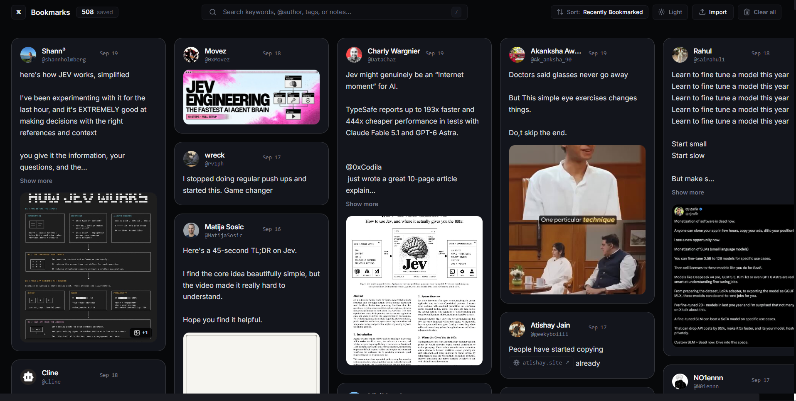
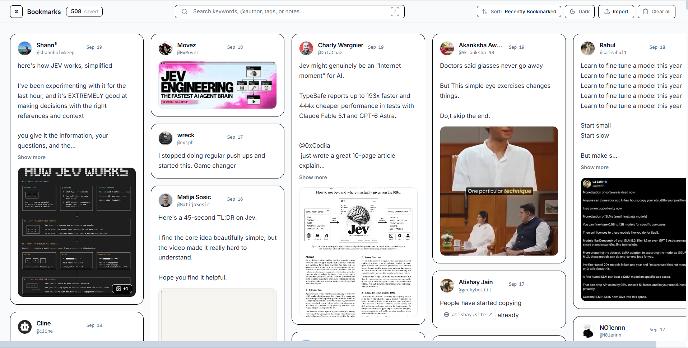
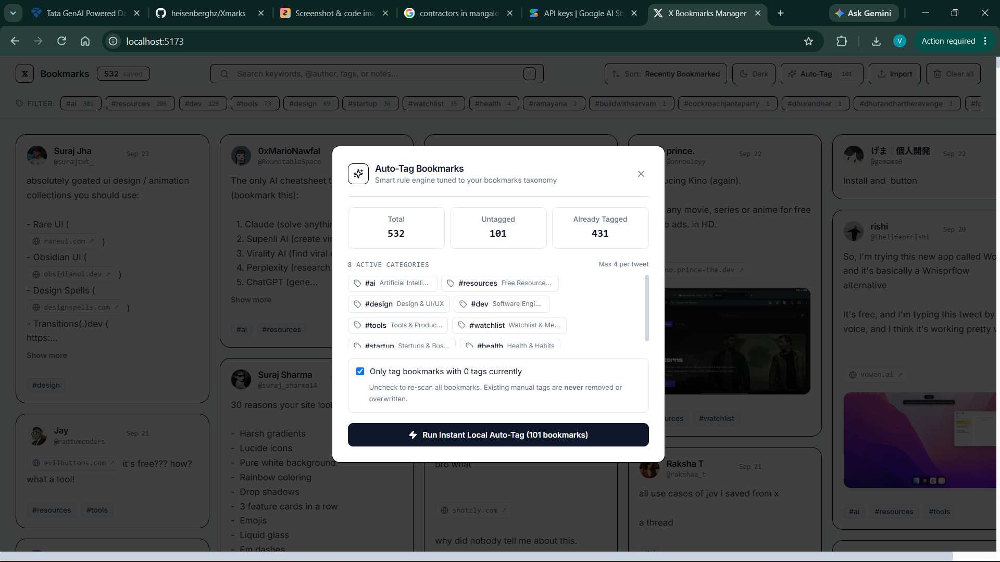

# 🔖 Xmarks — Your X (Twitter) Bookmarks, Finally Organized

> **A private, local-first personal knowledge system to capture, organize, auto-tag, and search your X (Twitter) bookmarks in a beautiful Pinterest-style masonry grid — with zero terminal commands, zero subscriptions, and zero cloud tracking.**

[](./LICENSE)
[](./extension)
[](https://react.dev/)
[](https://www.typescriptlang.org/)
[](https://tailwindcss.com/)
[](https://vitejs.dev/)
[](./tests)
[](#-100-privacy-first--no-cloud-needed)

---

## 📸 See It in Action

| 🌙 Dark Mode (Elevated Slate & Silver Hairline) | ☀️ Light Mode (High-Contrast Crisp Borders) |
|:---:|:---:|
|  |  |

<p align="center">
  
  <br />
  <em>⚡ Instant 8-Category Auto-Tagging Dialog with category breakdown & <code>#untagged</code> queue</em>
</p>

---

## 😫 The Problem: Twitter Bookmarks Are a Black Hole

If you use X (Twitter), you probably bookmark great threads, tutorials, code repos, design assets, and industry news every day.

**Here's the frustrating reality:**
1. **Endless black hole:** After saving a few hundred tweets, your bookmarks become an endless, single-column scroll where great ideas disappear forever.
2. **Search is paywalled:** X charges a monthly Premium subscription just to search your own saved bookmarks.
3. **No categorization:** You cannot add tags, organize collections, or write personal notes explaining *why* you saved a tweet.
4. **Developer APIs are expensive:** Scraping through the official Twitter API costs $100+/month.
5. **Transient:** If an author deletes a tweet or an account is suspended, your curated knowledge vanishes.

---

## 💡 What Xmarks Solves

**Xmarks** transforms Twitter bookmarks into an effortless, personal knowledge base:

* 🚀 **Zero-Terminal Chrome Extension:** The entire visual web app runs directly inside your Chrome browser. Open it as a **Full Tab** or in the **Chrome Side Panel** alongside your Twitter feed. No `npm run dev` or terminal needed for everyday use.
* ⚡ **Live Auto-Capture on X:** As you browse Twitter, clicking the native **Bookmark** button (or pressing <kbd>B</kbd>) silently captures the tweet into your local database with a subtle toast notification.
* 💸 **100% Free & Zero API Keys:** Scrape and sync your bookmarks directly from your authenticated browser session in seconds.
* 📌 **Pinterest-Style Visual Board:** View 20+ bookmarks at a glance with rich image galleries and video thumbnails instead of scrolling one tweet at a time.
* 🔍 **Instant Search (No Premium Required):** Find any bookmark in milliseconds. Search by keyword, author handle, author name, tags, or personal notes.
* 🧠 **Smart Sequence Stitcher:** Multi-batch scraping in any order (importing older archives or new scrapes) automatically aligns into exact Twitter chronology using anchor bridges and 64-bit Twitter Snowflake timestamps.
* 🏷️ **Instant 8-Category Auto-Tagging:** Automatically organizes your entire library into clean tags in under 0.2 seconds.
* 🎯 **Dedicated `#untagged` Queue:** Tweets that don't match standard categories get labeled `#untagged` so you can review them with one click.
* 📝 **Personal Notes:** Add private notes to any tweet. Perfect for remembering takeaways or action items (auto-saved to IndexedDB).
* 🔒 **100% Private & Local-First:** All data lives strictly in your browser's local `IndexedDB`. Zero tracking, zero cloud databases, and zero analytics.

---

## 📊 Comparison: Default Twitter vs. Xmarks

| Feature | Default X (Twitter) | Official API Tier | 🔖 **Xmarks (This Project)** |
|:---|:---:|:---:|:---:|
| **Cost** | Free (view only) | $100+/month | **100% Free & Open Source** |
| **Everyday Usage** | Native app | Developer code | **🚀 Chrome Extension (Dashboard + Side Panel)** |
| **Live Capture** | Native button only | Manual webhook | **⚡ Auto-saves on Bookmark button click / <kbd>B</kbd> key** |
| **Bookmark Search** | 🔒 Paid (X Premium required) | Developer setup needed | **⚡ Instant & Offline (No Subscription)** |
| **Auto-Tagging Engine** | ❌ None | ❌ None | **⚡ Instant 8-category rule engine + `#untagged` queue** |
| **Interface Layout** | Single-column infinite scroll | Raw JSON data | **📌 Pinterest-style Multi-column Masonry** |
| **Chronology Healing** | Scrambled on batch imports | Complex manual sorting | **🧠 Snowflake ID & Anchor Bridge Stitcher** |
| **Custom Tags** | ❌ None | ❌ None | **✅ Unlimited custom tags (`#react`, `#ideas`)** |
| **Personal Notes** | ❌ None | ❌ None | **✅ Inline notes per tweet with auto-save** |
| **Media Preview** | Inline only | URLs only | **🖼️ Fullscreen lightbox & multi-image carousels** |
| **Data Ownership** | Stored on X servers | Stored on your server | **🔒 100% Local (Saved in browser IndexedDB)** |
| **Works Offline?** | ❌ No | ❌ No | **✅ Yes, completely offline** |

---

## 🚀 Quickstart Guide

### Method 1: All-in-One Chrome Extension (Recommended for Daily Use)

No terminal, no dev servers. It runs permanently in your browser:

1. **Load Extension in Chrome**:
   - Open Chrome and navigate to `chrome://extensions/`.
   - Enable **Developer mode** in the top right corner.
   - Click **Load unpacked** (top left) and select the `extension` folder from this repository.
   - Click the puzzle icon (🧩) in your toolbar and **pin** the **X Bookmarks Manager** icon.
2. **Open Your Dashboard**:
   - Click the extension icon in your Chrome toolbar.
   - Click **"🚀 Open Full Dashboard"** (or **"📑 Open in Side Panel"**).
3. **Import Your Bookmarks**:
   - In the dashboard top bar, click **Import** and drop in any previous `bookmarks-export-*.json` file, or click **"Scrape Bookmarks Page"** in the extension popup while on [x.com/i/bookmarks](https://x.com/i/bookmarks).
4. **Browse & Auto-Save**:
   - As you browse Twitter, whenever you click the **Bookmark** button on any tweet, it is automatically captured and saved into your library in real time!

---

### Method 2: Standalone Local Web App (For Development)

If you are developing or modifying the React codebase:

```bash
# 1. Clone repository
git clone https://github.com/heisenberghz/Xmarks.git
cd Xmarks

# 2. Install dependencies
npm install
cd app && npm install && cd ..

# 3. Start local development server
npm run dev
```

Open [http://localhost:5173](http://localhost:5173) in your browser. (The app is locked to port 5173 with `strictPort: true` to prevent origin-partitioned IndexedDB hopping).

---

### Method 3: Standalone DevTools Console Script (Zero Install)

If you only want a quick one-time export without installing the extension:

1. In Google Chrome, go to [x.com/i/bookmarks](https://x.com/i/bookmarks) while logged in.
2. Open DevTools (<kbd>F12</kbd> or <kbd>Ctrl</kbd>+<kbd>Shift</kbd>+<kbd>I</kbd>).
3. Switch to the **Console** tab.
4. Copy the entire contents of [`extension/standalone/console-scraper.js`](./extension/standalone/console-scraper.js), paste it into the console, and hit <kbd>Enter</kbd>.
5. The script scrolls humanly, harvests bookmarks, and downloads `bookmarks-export-<timestamp>.json`.

---

## ✨ Features Deep-Dive

### 1. ⚡ Live Auto-Capture & Background Sync
* **Zero friction:** You never have to manually export or upload files again.
* **Passive curation:** Clicking the bookmark ribbon on any tweet on `x.com` extracts the author, handle, avatar, tweet text, media, and permalink, saving it directly into your local database.
* **Instant confirmation:** Shows a subtle floating toast on X: `🔖 Saved to X Bookmarks Manager`.
* **Live updates:** If your dashboard is open in another tab or in the Side Panel, new cards stream onto your screen live without reloading.

### 2. 🧠 Intelligent Sequence Stitching & Snowflake Chronology
* **Multi-Batch Bridge:** When importing separate scrapes (e.g. today's 80 tweets and last month's 500 tweets), the importer locates overlapping anchor tweets and stitches them seamlessly.
* **Twitter Snowflake Decoding:** Tweet IDs are 64-bit snowflakes (`(id >> 22) + epoch`). The app extracts exact millisecond creation timestamps to guarantee correct timeline order even when batches don't overlap.
* **1-Click Realign Order:** Corrupted an old import? Click **"Realign Timeline Order"** in the Sort dropdown to re-index your entire library in 1 click.
* **Preserves Annotations:** Re-importing or stitching never overwrites your manual tags, notes, or imported dates.

### 3. 🏷️ Smart Auto-Tagging & `#untagged` Review Queue
* **100% Offline & Instant:** Scans 500+ bookmarks in under 0.2 seconds without sending data anywhere.
* **8 Curated Categories:**
  * `#ai`: LLMs, agents, Claude, OpenAI, DeepSeek, prompts, fine-tuning.
  * `#resources`: Free books, courses, roadmaps, cheat sheets, guides.
  * `#design`: UI/UX, Figma, typography, typefaces, landing pages, animations.
  * `#dev`: Coding, GitHub repositories, systems, architecture, backend, frontend.
  * `#tools`: Cursor, browser extensions, automation, productivity utilities.
  * `#watchlist`: Curated thriller series, movie threads, documentaries.
  * `#startup`: SaaS, monetization, building in public, marketing, founders.
  * `#health`: Workouts, posture, eye exercises, health habits.
* **Hashtags & Domain Recognition:** Pulls native `#hashtags` from tweets and maps domains (GitHub, Figma, Goalkicker, ArXiv).
* **Dedicated `#untagged` Queue:** Unmatched tweets get labeled `#untagged` so you can find them in your top filter bar with one click.

### 4. 📌 Pinterest-Style Responsive Grid
* Modern **16px rounded curves** (`rounded-2xl`) with matching **12px inner media corners**.
* **High-contrast styling:** Crisp 1px solid black borders in Light Mode, and elevated slate surfaces with subtle silver hairline borders in Dark Mode.
* Clickable `@mentions`, external links, and inline `#tags` directly on cards.

### 5. 🔍 Blazing Fast Search & Tag Filters
* Sub-millisecond client-side search across all tweet content, author names, handles, notes, and tags.
* Multi-select tag filters with `OR` / `AND` logic modes.
* Sort easily by **Recently Bookmarked**, **Newest First**, or **Oldest First**.

### 6. 📝 Personal Notes & Annotations
* Click any card to open the slide-out detail drawer.
* Add private notes, takeaways, or research links saved directly to IndexedDB.
* Navigate smoothly between bookmarks using <kbd>←</kbd> and <kbd>→</kbd> arrow keys.

---

## 🏗️ Project Architecture

```text
Xmarks/
├── app/                              # React + TypeScript + Vite + Tailwind Web App
│   ├── src/
│   │   ├── components/               # TopNav, MasonryGrid, DetailPanel, AutoTagModal, etc.
│   │   ├── db/                       # indexedDB.ts (storage persistence & CRUD)
│   │   ├── lib/                      # importer.ts, search.ts, tagRules.ts, linkify.ts, useTheme.ts
│   │   └── types/                    # Bookmark, SortMode, ImportResult types
│   └── vite.config.ts                # Strict port 5173 + relative build outDir to extension/dashboard
│
├── extension/                        # Manifest V3 Chrome Extension (Dashboard + Live Capture)
│   ├── manifest.json                 # Permissions (sidePanel, storage, unlimitedStorage)
│   ├── dashboard/                    # Pre-built, zero-server React dashboard (index.html + assets)
│   ├── src/
│   │   ├── background.js             # Service worker: IndexedDB persistence, tabs, live message bus
│   │   ├── content.js                # Live capture on x.com clicks & bulk timeline scraper
│   │   ├── extractor.js              # DOM parser for text, media, avatars, and handles
│   │   ├── scroller.js               # Smooth humanized auto-scroller with deduplication
│   │   ├── popup.html & popup.js     # Extension popup UI (Launchers & Scraper controls)
│   └── standalone/
│       └── console-scraper.js        # Zero-install standalone DevTools scraper
│
├── sample-data/
│   └── bookmarks-export-sample.json  # Sanitized sample dataset for instant testing
│
├── screenshots/                      # UI previews and showcase screenshots
├── tests/                            # Vitest automated test suite (DOM parsing, scroller, tag engine)
├── .gitignore                        # Strict rules to keep personal bookmark dumps private
├── LICENSE                           # Open source MIT license
└── package.json                      # Workspace scripts (dev, build, test)
```

---

## 🧪 Testing & Verification

The automated test suite verifies DOM tweet extraction, multi-image and video poster parsing, virtual scroll unmounting, deduplication, search ranking, theme logic, snowflake timestamp decoding, sequence stitching, and manifest capabilities:

```bash
# Run Vitest across all test suites (58 tests)
npm test

# Build extension dashboard bundle
npm run build
```

---

## 🔒 100% Privacy First — No Cloud Needed

* **Zero Cloud Storage:** All bookmarks, notes, and tags remain on your machine in browser IndexedDB.
* **Storage Eviction Protected:** Uses `navigator.storage.persist()` on boot so your browser never cleans up your bookmarks during disk cleanup.
* **Zero Telemetry:** No tracking, no cookies, no third-party analytics scripts.
* **Safe Git Defaults:** [`.gitignore`](./.gitignore) is pre-configured to ignore personal `bookmarks-export*.json` files.

---

## ❓ Frequently Asked Questions

<details>
<summary><b>Do I need to keep a terminal or dev server running?</b></summary>
<p>No! Once you load the unpacked <code>extension</code> folder in Chrome, you never have to run <code>npm run dev</code> or open a terminal again. Simply click the extension icon to open the full dashboard in a tab or in the Chrome Side Panel.</p>
</details>

<details>
<summary><b>Will my X (Twitter) account get banned or flagged?</b></summary>
<p>No. Both the live capture and bulk scraper simply read the tweets rendered in your browser, identical to your regular browsing. They do not send automated API requests or bypass security checks.</p>
</details>

<details>
<summary><b>Do I need to pay for Twitter / X Premium?</b></summary>
<p>No! That is the core mission of Xmarks. You can capture, search, and auto-tag all your bookmarks with zero subscriptions.</p>
</details>

<details>
<summary><b>How does Live Capture work?</b></summary>
<p>Whenever you are browsing <code>x.com</code> and click the native Bookmark ribbon button on any tweet (or press <kbd>B</kbd>), the extension detects the click, extracts the tweet data, and saves it directly into your local database with a quick confirmation toast.</p>
</details>

<details>
<summary><b>Can I backup or export my data again?</b></summary>
<p>Yes. The bulk scraper automatically creates clean JSON backups, and the database can be exported at any time.</p>
</details>

---

## ⚖️ License

Distributed under the [MIT License](./LICENSE).

---

*Disclaimer: This project is an independent open-source personal productivity tool and is not affiliated with, endorsed by, or associated with X Corp.*
